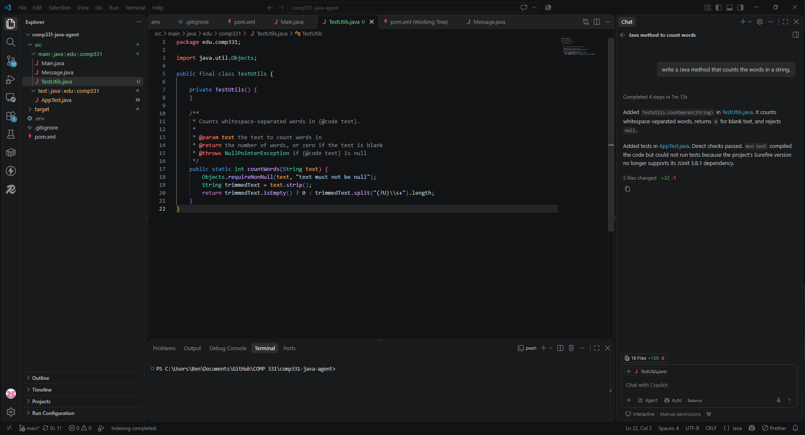
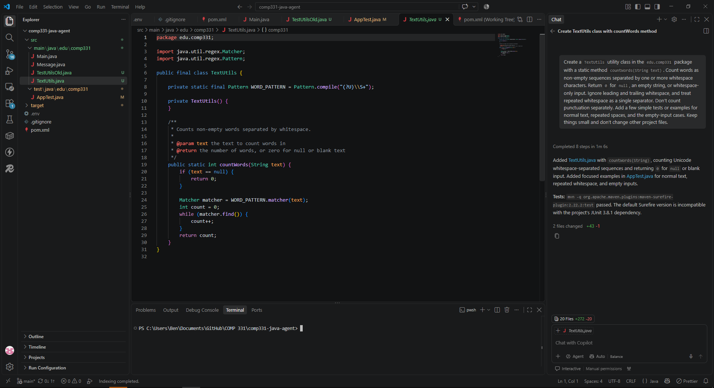
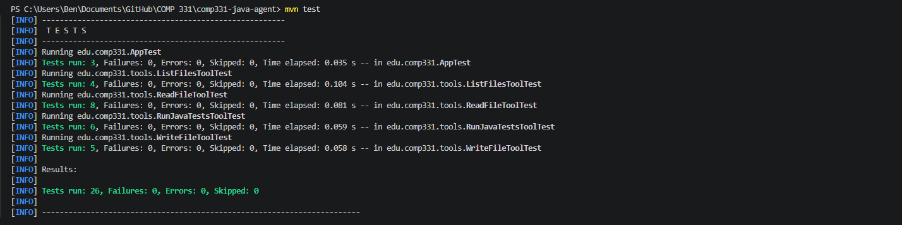
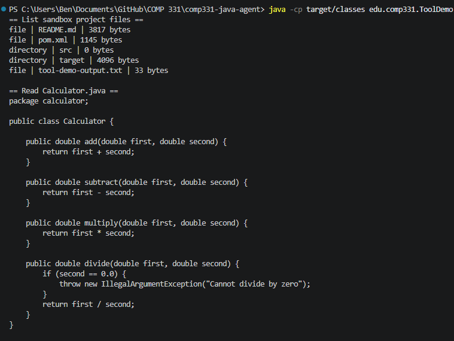
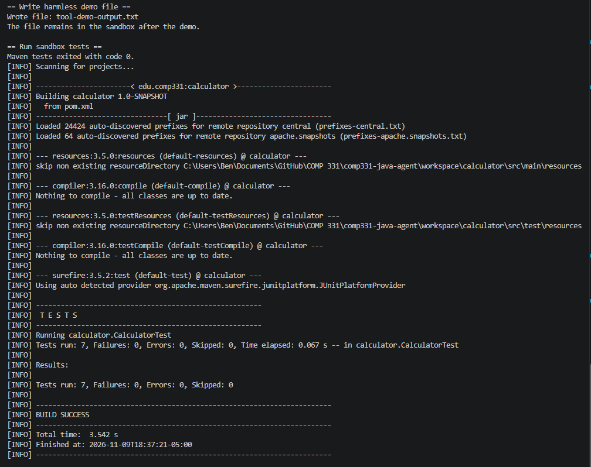

# COMP331 Java Agent

A Java Maven command-line project for sending prompts to an LLM, with a small utility feature developed first from an informal request and then from a structured task specification.

## Setup

You’ll need a JDK and Maven. From the project folder (the one with `pom.xml`), check that they’re installed:

```powershell
java -version
mvn -version
```

Put your Gemini API key in a `.env` file next to `pom.xml`:

```text
GEMINI_API_KEY=your_api_key_here
```

Make sure `.env` is in `.gitignore so the key doesn’t get committed.

## Running the program

From the project folder, run the program with a prompt:

```powershell
mvn compile exec:java "-Dexec.args=Explain this Java method"
```

Add `--verbose` to see extra information, such as the model, prompt, and token counts if the API returns them:

```powershell
mvn compile exec:java "-Dexec.args=--verbose Explain this Java method"
```

## Word counter

### Task specification

- **Goal:** Count the words in a string.
- **Input:** A Java `String`.
- **Output:** The number of words as an integer.
- **What counts as a word:** A group of non-whitespace characters. Punctuation stays attached to the word.
- **Constraints:** Put the method in a small utility class. Don’t change the Gemini API code.
- **Edge cases:** `null`, empty text, and whitespace-only text return `0`. Spaces, tabs, and line breaks separate words.
- **Examples:** `"hello world"` returns `2`; `"  hello   world "` returns `2`; `"one\ntwo"` returns `2`; `null` returns `0`.

### First attempt



**Prompt:**  
"Write a Java method that counts words in a string"

**What it returned:**  
Code was renamed and saved as TextUtilsOld.java

### Structured attempt



Task specifications were used to make this structured prompt:

**Prompt:**
"Create a `TextUtils` utility class in the `edu.comp331` package with a static method `countWords(String text)`. Count words as non-empty sequences separated by one or more whitespace characters. Return `0` for `null`, an empty string, or whitespace-only input. Ignore leading and trailing whitespace, and treat repeated whitespace as a single separator. Don’t count punctuation separately. Add a few simple tests or examples for normal text, repeated spaces, and the empty-input cases. Keep things small and don’t change other project files."

**What it returned:**
It created TextUtils.java as well as multiple tests inside AppTest.java

### Comparison

The code created using the naive prompt did surprisingly well in covering fail cases, but it fails to return 0 for an empty string. It also used a completely different approach using the Pattern class.

## Lab 3: Sandbox Tools

### Architecture

- `AgentTool` defines the common interface.
- `SandboxFileStore` provides list/read/write operations.
- `SandboxPaths` validates paths.
- `RunJavaTestsTool` runs tests for a maven project.
- `workspace/calculator` is the sandbox root.

## Running Tests and the demo

```powershell
mvn test
mvn compile
java -cp target/classes edu.comp331.ToolDemo
```

The demo creates `workspace/calculator/tool-demo-output.txt` and leaves it there.

## JUnit tests passed



## Demo Output



## Demo Output tests passed



## Limitations

- Path checks only block ordinary traversal and symlink.
- The demo leaves `workspace/calculator/tool-demo-output.txt` behind.
- Maven can execute project code/plugins.

## AI Usage

### Accepted

I accepted a proposal to inject a process runner so the command restriction could be tested without launching Maven. The test verifies that the runner receives only the fixed Maven test command. The tool tests passed.

### Revised

The original path-traversal test name `../outside.txt` but did not create that file. I revised it by creating an existing file oustide the sandbox for testing.
