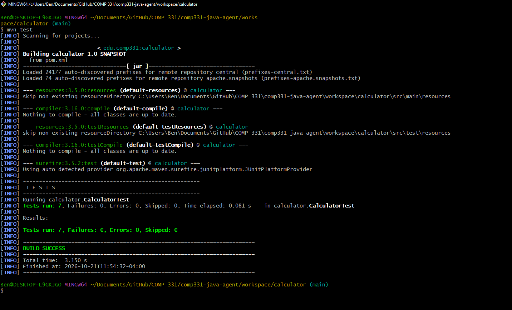
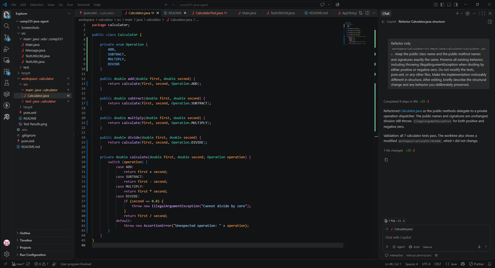
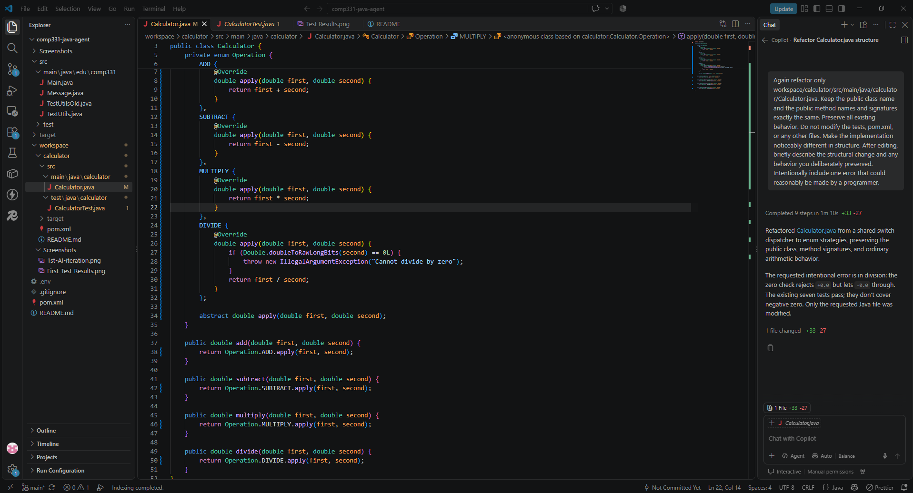

## Acceptance criteria

Run all automated checks from this directory with `mvn test`.

| Criterion                                                                                          | How it is checked                                                                                            |
| -------------------------------------------------------------------------------------------------- | ------------------------------------------------------------------------------------------------------------ |
| Addition, subtraction, multiplication, and division return the correct result for ordinary inputs. | `addsTwoNumbers`, `subtractsTwoNumbers`, `multipliesTwoNumbers`, and `dividesTwoNumbers` in `CalculatorTest` |
| Addition works with negative operands.                                                             | `supportsNegativeNumbers`                                                                                    |
| Multiplying an operand by zero returns zero.                                                       | `supportsZeroAsAnOperand`                                                                                    |
| Dividing by zero is rejected with `IllegalArgumentException`.                                      | `rejectsDivisionByZero`                                                                                      |
| All calculator tests pass when run through Maven.                                                  | Run `mvn test`; confirm the build succeeds and the test summary reports no failures or errors.               |

The tests use a small tolerance when comparing decimal results. Human review should also confirm that the test names and assertions match the intended calculator behavior.

### 1st Implementation Test Results:

Commit hash: 9a4a698ecf80ba5333f1c528ab1e92062c92eda2

### 1st AI Iteration Test Results:

Commit hash: e8a035491794838dd1d00ec70c8e3dee9c96519e

Prompt: "Refactor only workspace/calculator/src/main/java/calculator/Calculator.java. Keep the public class name and the public method names and signatures exactly the same. Preserve all existing behavior, including throwing IllegalArgumentException when dividing by either positive or negative zero. Do not modify the tests, pom.xml, or any other files. Make the implementation noticeably different in structure. After editing, briefly describe the structural change and any behavior you deliberately preserved."

### 2nd AI Iteration Test Results:

Commit hash: f6c4f99794a2c4c0b84cf94408e30d58c9c0c9c1

Prompt: "Again refactor only workspace/calculator/src/main/java/calculator/Calculator.java. Keep the public class name and the public method names and signatures exactly the same. Preserve all existing behavior. Do not modify the tests, pom.xml, or any other files. Make the implementation noticeably different in structure. After editing, briefly describe the structural change and any behavior you deliberately preserved. Intentionally include one error that could reasonably be made by a programmer."

### Comparison

The code generated by the AI gives a great example on how the same idea can be implemented for different purposes. My implementation focused on a simple, functioning calculator with the 4 basic methods, while the AI implemented a scaleable version using a shared calculate() method. Ultimately I think the simpler approach makes more sense for this project, but the scaleable version definitely has its use in a larger project that may wish to introduce more shared logic using the calculator() method.
